# Icarus Server Manager + Prospect Editor

[](https://github.com/DukeVenator/Icarus-Server-Manager-Tool/actions/workflows/dotnet-ci.yml)
[](https://codecov.io/gh/DukeVenator/Icarus-Server-Manager-Tool)
[](https://github.com/DukeVenator/Icarus-Server-Manager-Tool/releases)
[](https://github.com/DukeVenator/Icarus-Server-Manager-Tool/releases)
[](LICENSE.md)
[](https://dotnet.microsoft.com/download/dotnet/8.0)

I run an Icarus dedicated server for my tabletop group. After too many nights spent hand-editing
JSON and checking whether the server had actually stayed up, I wrote two small Windows tools to do
the boring parts for me.

- **Icarus Server Manager** installs, configures, runs and watches the dedicated server.
- **Icarus Prospect Editor** edits prospect saves without turning them into soup.

They're free, they're what my group uses, and 3.0 is the version I'm happiest with so far.

<!-- MANAGER_RELEASE_BLOCK -->
**Latest Server Manager release:** [manager-v3.0.0](https://github.com/DukeVenator/Icarus-Server-Manager-Tool/releases/tag/manager-v3.0.0) — on that page, download **IcarusServerManager-manager-v3.0.0-win-x64.zip** from **Assets** (Windows; requires [.NET 8 Desktop Runtime](https://dotnet.microsoft.com/download/dotnet/8.0)).
<!-- /MANAGER_RELEASE_BLOCK -->

<!-- EDITOR_RELEASE_BLOCK -->
**Latest Prospect Editor release:** [editor-v3.0.0](https://github.com/DukeVenator/Icarus-Server-Manager-Tool/releases/tag/editor-v3.0.0) — on that page, download **IcarusProspectEditor-editor-v3.0.0-win-x64.zip** from **Assets** (Windows; requires [.NET 8 Desktop Runtime](https://dotnet.microsoft.com/download/dotnet/8.0)).
<!-- /EDITOR_RELEASE_BLOCK -->

**Last tested with Icarus Dedicated Server build:** 230

> **3.0 is a rewrite, not a feature drop.** I rebuilt both tools around one rule: don't say
> something worked until it has. Saves are written to a temporary file, read back, then swapped in.
> Editor drafts survive refreshes and recorder removal. Mount fields and talents apply together.
> The manager keeps hold of a server it can't confirm has stopped instead of starting a second one.
> The editor also got a proper UI pass. Full details in [CHANGELOG.md](CHANGELOG.md).

---

## Which one do I need?

**The manager**, if you want to:

- install or update the dedicated server without fighting SteamCMD by hand
- start, stop and restart it from a window instead of a console you forgot to keep open
- change INI settings, keep backups, and see CPU, memory and uptime
- get a Discord ping when something happens

**The editor**, if you want to:

- fix a prospect's name, difficulty or expiry
- add, remove or rename members and custom settings
- edit a mount's species, genetics or talents without touching raw binary
- look at recorder data when something has gone weird

The two apps don't depend on each other. Use one, the other, or both.

---

## Server Manager quick start

1. Download the manager zip from the release block above.
2. Extract it somewhere sensible and run `IcarusServerManager.exe`.
3. Open **Manager Settings**, set the server install folder, or run the **Setup wizard**.
4. Click **Install/Update Server**.
5. Fill in **Server Settings**.
6. Click **Save to INI**, then **Save Manager Options**.
7. Click **Start Server** and watch the **Console** tab.
8. Once it has run cleanly for a while, set up restart policies and Discord notifications.

The first install pulls a few gigabytes through SteamCMD. The window stays usable while it runs,
and it refuses to start the server until the install actually produced a server executable.

---

## Prospect Editor quick start

1. Download the editor zip from the release block above.
2. Extract it and run `IcarusProspectEditor.exe`.
3. Click **Open Prospect** and pick a prospect JSON. You can also hand it a file on the command
   line: `IcarusProspectEditor.exe "C:\path\to\prospect.json"` or `--open <path>`. Dragging a file
   onto the exe works too.
4. Edit what you need. The tabs are Metadata, Members, Custom Settings, Characters, Missions,
   Prebuilts, Mounts and Diagnostics.
5. Click **Save**. You get a confirmation with a summary first, and a `.bak` of the old file every
   time.


### Please keep your own backups

The editor writes a backup and validates before replacing anything, but it cannot save you from an
edit that is valid JSON and nonsense to the game.

- Keep a copy of the prospect outside the editor's backup chain.
- Use **Save As** before a big change.
- Treat the Advanced raw field editors as a last resort.

You accept the risk of editing your own saves. I can't be liable for lost worlds or corrupted
prospects.

---

## What the manager does

**Installing and running**

- Installs or updates the dedicated server through SteamCMD.
- Starts, stops, restarts and force-stops it from the app.
- Only one lifecycle operation can own the server at a time.
- If a stop can't confirm the process exited, the manager keeps the handle and refuses to launch a
  replacement. Better a stuck server than two of them.
- Refuses to close mid-operation or mid-install.

**Keeping it alive**

- Restarts after a crash, with a retry budget that only resets after ten stable minutes.
- Restarts on a schedule (every X hours) and inside a daily maintenance window.
- Restarts when memory stays too high or when the server has been empty too long.
- A manager-initiated shutdown is never counted as a crash.

**Seeing what's happening**

- Console with filters and presets (Minimal, Balanced, Verbose, QuietGame, Custom).
- CPU, memory and uptime stats, with a chart and CSV export.
- Last World view, plus a prospect picker for swapping the active world.
- Player hints parsed from the server log.

**Config and backups**

- Server Settings editor that writes the INI for you.
- Save and load presets, export and import full config bundles.
- One-click INI backup, plus world backups to a zip or folder.
- Light and dark theme, and a built-in update checker for the manager itself.
- Options migrate automatically, with a backup. A malformed options file is left alone rather than
  overwritten with defaults.

**Discord**

- Notifications for lifecycle, player and operational events, each with its own toggle.
- Spam control for busy channels.
- Diagnostics record the host, status code and exception type. URLs, tokens, payloads and response
  bodies stay out of the logs.

**Scheduled restarts** are restarts only. They never run SteamCMD updates, and the labels say so.
A late timer tick still counts for 15 minutes instead of silently skipping the day.

---

## What the editor does

**Opening and saving**

- Opens encoded prospect saves directly.
- Saves to a temp file, reads it back as a valid prospect, then swaps it in.
- Creates a backup before replacing anything, and never deletes backups for you.
- Keeps your unsaved drafts out of the live document until the save has actually succeeded.
- Save As only moves the document path after the new file is written.

**Editing**

- Metadata: identity, ownership, gameplay and timing fields, with an Advanced identifiers section.
- Members and custom settings, including row-level revert.
- Eight tabs, including Characters, Missions and Prebuilts recorder views.
- A recorder inspector for the raw fields, if you really need it.
- Validation per field. A bad value blocks the whole save instead of half-applying.
- Warnings before actions that can break a live world.

**Mounts**

- A dedicated mount editor with Overview, Genetics, Talents and Advanced tabs.
- Species swap with a preview tied to the species and talents it was calculated from.
- Genetics radar and clamped sliders.
- Talent rank changes, additions and deletions that actually reach the save.
- Unknown stored species stay selectable instead of being replaced by whatever is first in the list.

**Not losing work**

- Recorder edits and removals count as unsaved changes.
- Removing recorders keeps pending metadata, member, setting and mount edits.
- Revert Selected restores the row you changed, rather than deleting it.
- Revert All reloads from disk after a confirmation.
- Closing or opening another prospect offers Save, Discard or Cancel.

**Interface**

- Responsive layout that reflows instead of clipping when the window is narrow.
- Light and dark themes, including the menu bar and tab strip.
- Built-in update checker for the editor.
- Sortable tables, with a sort glyph. Sorting doesn't mark the document dirty.
- Header shows the prospect name, a middle-ellipsized path, and a Copy path button.
- Accessible names on inputs, checkboxes, the tab strip and every grid.
- Keyboard shortcuts that are actually bound (Ctrl+O, Ctrl+S, Ctrl+Shift+S, Ctrl+E, Ctrl+R,
  Ctrl+Shift+R, F5).

**Exports**

- Raw or enriched decoded JSON export, from a snapshot taken when the export starts.
- Refuses to write over the source file, including relative-path and case aliases.
- Refuses to overwrite an existing file that still reads as an encoded prospect.

### Mount editor screenshots

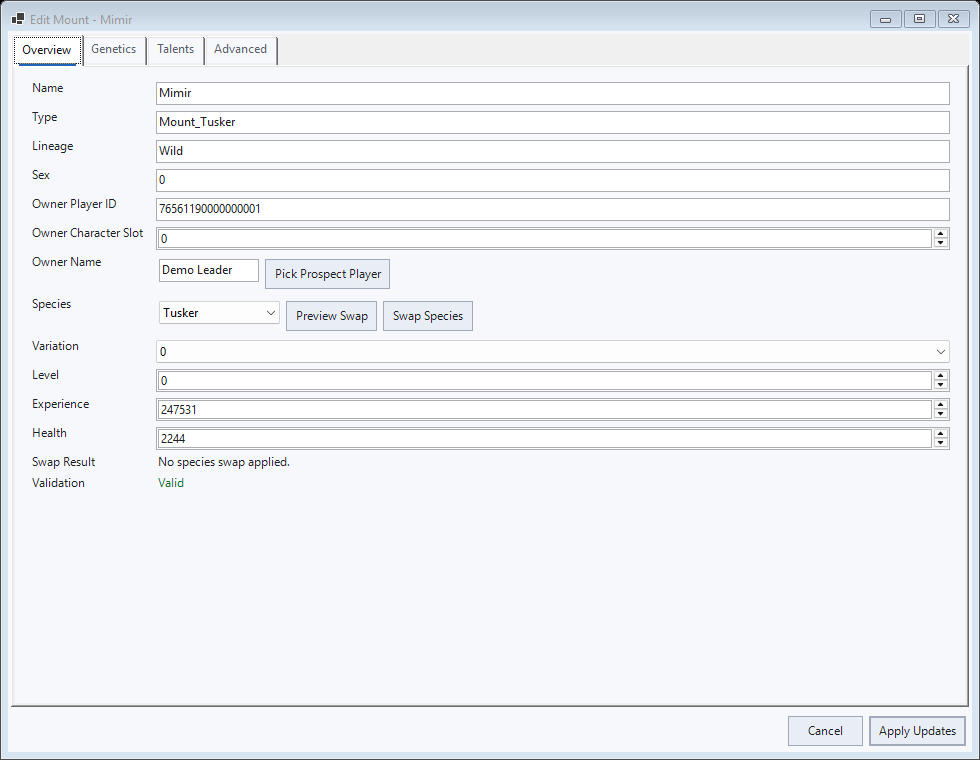

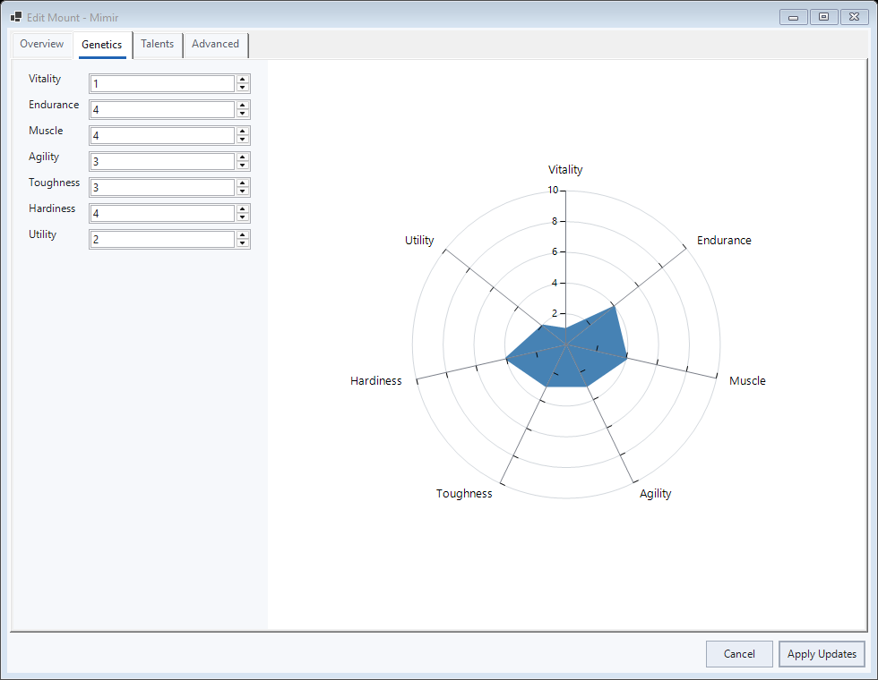

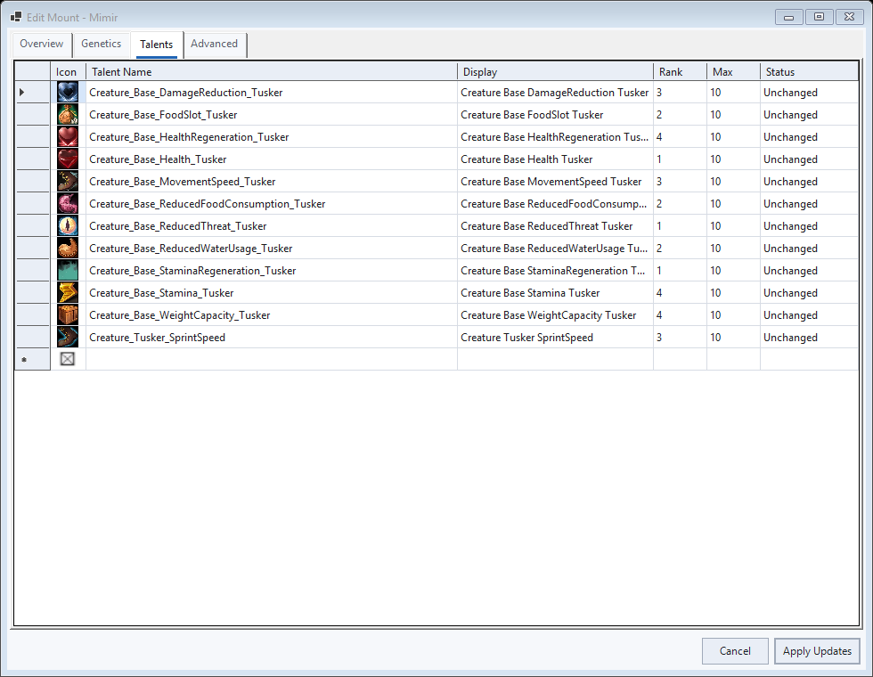

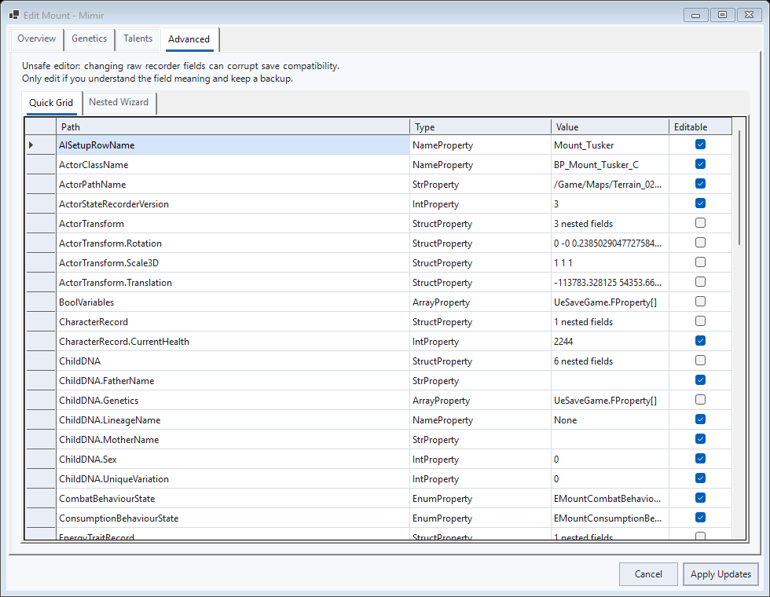

---

## More screenshots

The shell keeps all eight tabs, both themes, and a status line that knows the difference between
saved, edited and failed.

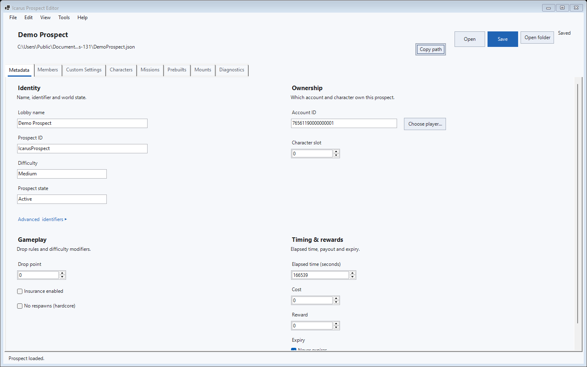

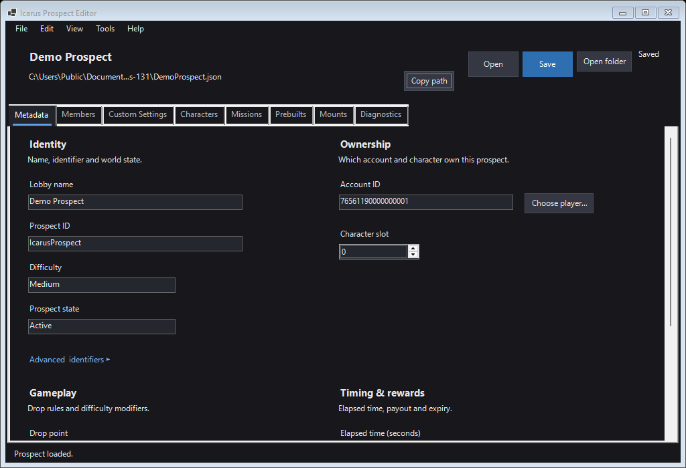

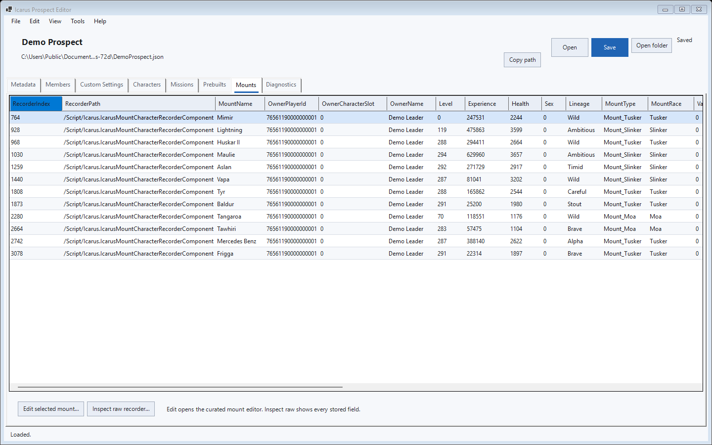

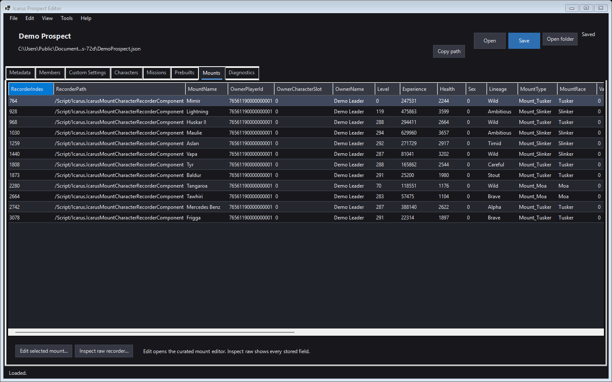

| Members | Characters |
| --- | --- |
| 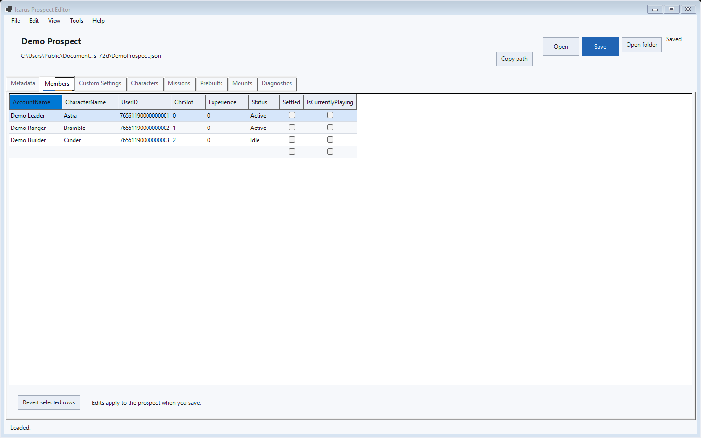 | 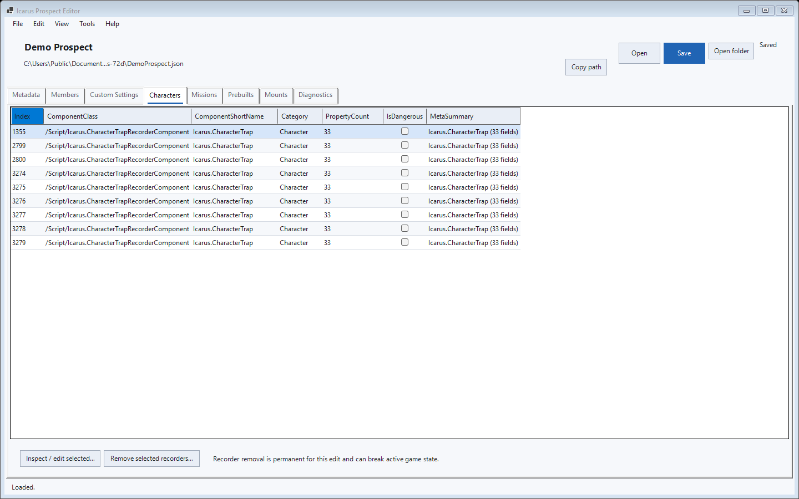 |

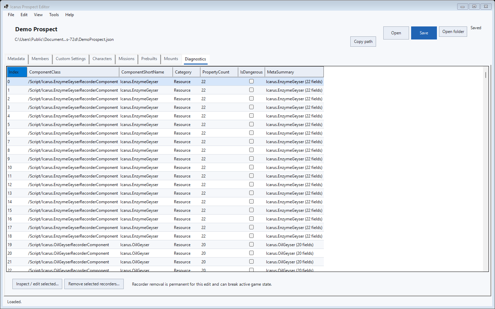

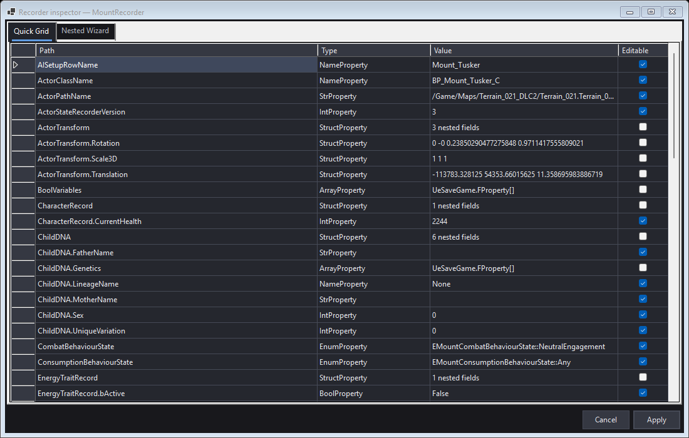

More editor views are documented in the [Prospect Editor wiki pages](https://github.com/DukeVenator/Icarus-Server-Manager-Tool/wiki).

---

## Things I do often

**Change the server name or ports**

1. Open **Server Settings**.
2. Edit the values.
3. Click **Save to INI**.
4. Restart from the app.

**Move a server to another machine**

1. Export a config bundle.
2. Copy it over.
3. Import it and fix any paths that changed.

**Back up a world**

- Use the backup actions in **Server Settings**, either a zip or a folder copy.

**Undo a bad prospect edit**

- If you haven't saved: **Revert All**.
- If you have: restore the `.bak` file that sits next to the prospect.

---

## Requirements

- Windows
- [.NET 8 Desktop Runtime](https://dotnet.microsoft.com/download/dotnet/8.0) for the release zips
- .NET 8 SDK if you want to build it yourself

---

## Where it keeps files

- Manager options: `%LocalAppData%\IcarusServerManager\manager-options.json`
- Manager logs: `logs\manager-YYYYMMDD.log` next to the executable
- Editor logs: `%LocalAppData%\IcarusProspectEditor\logs\`
- Editor update settings: `%LocalAppData%\IcarusProspectEditor\prospect-editor-update.json`
- Server INI default: `Icarus\Saved\Config\WindowsServer\ServerSettings.ini`

---

## Building it yourself

```bash
dotnet restore IcarusServerManager.sln
dotnet build IcarusServerManager.sln -c Release
dotnet test IcarusServerManager.sln -c Release
```

```bash
dotnet publish IcarusServerManager/IcarusServerManager.csproj -c Release -r win-x64 --self-contained false -o ./publish
dotnet publish IcarusProspectEditor/IcarusProspectEditor.csproj -c Release -r win-x64 --self-contained false -o ./publish-editor
```

The version comes from the git tag. A tagged commit builds that exact version; anything after a tag
builds the next prerelease with the commit hash. You don't edit version numbers in the projects.

---

## Releases and CI

Tags drive everything:

- Server Manager: `manager-vX.Y.Z` (legacy `vX.Y.Z` still works)
- Prospect Editor: `editor-vX.Y.Z`

`dotnet-ci.yml` builds and tests branches and pull requests. The two release workflows build the
zips, create the GitHub release, and update the release block at the top of this file.

```bash
git tag -a manager-v3.0.0 -m "Icarus Server Manager 3.0.0"
git push origin manager-v3.0.0

git tag -a editor-v3.0.0 -m "Icarus Prospect Editor 3.0.0"
git push origin editor-v3.0.0
```

---

## Wiki and references

- [Project wiki](https://github.com/DukeVenator/Icarus-Server-Manager-Tool/wiki)
- [Icarus dedicated server config and launch parameters](https://github.com/RocketWerkz/IcarusDedicatedServer/wiki/Server-Config-&-Launch-Parameters)

---

## License

GPLv3. See [LICENSE.md](LICENSE.md).
